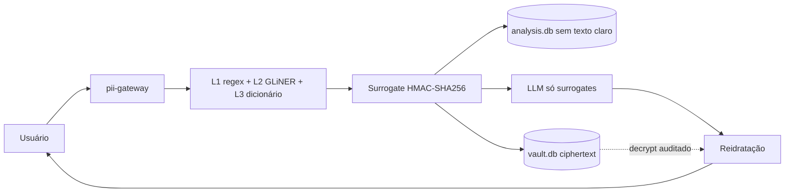

# pii-gateway

Demonstração do middleware descrito no relatório técnico: o texto com dados pessoais é pseudonimizado **antes** de sair da máquina, o modelo só vê substitutos determinísticos e a resposta é reidratada aqui. O banco analítico não recebe texto claro.

Isto é uma prova de conceito, não um produto.

## O que isto prova

1. Texto com PII entra e só surrogates seguem para o LLM.
2. A resposta volta com os valores reais, no perímetro local.
3. `analysis.db` guarda surrogate, tipo e hash. O valor original fica só cifrado em `vault.db`, e cada decrypt grava uma linha em `vault_access_log`.



## Quickstart

Requer Python 3.13. O `uv` instala o interpretador se precisar.

```bash
uv sync
cp .env.example .env
uv run uvicorn pii_gateway.app:app --host 127.0.0.1 --port 8000
```

Abra http://127.0.0.1:8000.

Para a L2 de verdade (baixa o `torch` e, na primeira chamada, o modelo):

```bash
uv sync --extra ner
```

`ENABLE_NER` vem ligado no `.env.example`. Sem o extra, a API avisa e segue com L1 e L3. Os testes não baixam modelo.

Sem chave de provedor, ponha `LLM_MOCK=true` no `.env` para a síntese local. Com chave, use a API compatível com OpenAI (`LLM_BASE_URL`, `LLM_API_KEY`, `LLM_MODEL`). Não commite o `.env`.

Docker, sem o modelo neural:

```bash
docker compose up --build
```

## Roteiro de cinco minutos

1. Suba o servidor e abra a página. O texto de exemplo já é um caso **inventado** (Helena Duarte Ferreira, Oficina Luminar Ltda, CPF `123.456.789-09`, CNPJ `12.345.678/0001-95`, e-mail em `example.com`).
2. Confira o dicionário do caso e a allow-list. O tribunal e o Ministério Público ficam em claro de propósito.
3. Clique em **Sanitizar e perguntar**.
4. Compare os quatro painéis: o texto enviado ao LLM só tem tokens `PERSON_`, `CPF_`, `ORG_` e afins; a resposta reidratada devolve os valores.
5. Olhe as tabelas lado a lado. Em `analysis` não há o nome nem o CPF; em `vault` o ciphertext está em base64 e o log ganha uma linha `rehydrate` por decrypt. **Limpar stores** zera os dois arquivos para repetir.

## Como a demo decide

- **L1.** Regex e dígito verificador (módulo 11) para CPF e CNPJ. E-mail por formato. Telefone brasileiro por DDD e forma (móvel com 9, fixo com 2–5): não existe dígito verificador nacional.
- **L2.** GLiNER em processo, CPU, modelo conferido: [`urchade/gliner_multi_pii-v1`](https://huggingface.co/urchade/gliner_multi_pii-v1). Carga preguiçosa. Desliga com `ENABLE_NER=false`.
- **L3.** Termos do caso, busca sem acento e sem diferença de maiúsculas. Um acerto da L2 entra no dicionário e é procurado no texto inteiro, inclusive a variação `H. Ferreira`. A allow-list tira o termo da redação.
- **Sobreposição.** O trecho mais longo vence. No empate, L1 > L3 > L2. Um identificador da L1 que não fique inteiro dentro do vencedor é mantido e o outro trecho é partido ao redor dele.
- **Surrogate.** `PREFIXO_` mais os 8 primeiros hex de `HMAC-SHA256(Norm(v), TENANT_KEY)`. Prefixos: `PERSON`, `ORG`, `CPF`, `CNPJ`, `EMAIL`, `PHONE`, `ADDRESS`. A normalização tira a máscara de CPF, CNPJ e telefone, então `123.456.789-09` e `12345678909` coincidem. O tipo não entra no HMAC. Se o surrogate de 8 hex já apontar para outro valor, o hex cresce (12, 16, 24, 32, 64). Colisão do HMAC inteiro responde 409.
- **Cofre.** AES-256-GCM (`cryptography`). `VAULT_KEY` em hex/base64 de 32 bytes, ou qualquer frase da qual se deriva SHA-256.
- **Stores.** Dois SQLite (`ANALYSIS_DB_URL`, `VAULT_DB_URL`) via SQLAlchemy, com `String`, `DateTime` e `LargeBinary`. Trocar para Postgres é trocar a URL. `entity.value_hash` é o HMAC completo, não o texto.

A reidratação de stream, com retenção de 32 caracteres para um surrogate partido entre chunks, está em `pii_gateway/stream.py` e coberta por teste. O endpoint `/ask` desta demo não transmite em streaming.

## O que é simulado e o que ficou de fora

- **KMS simulado.** A chave do cofre vive no processo. Não há envelope encryption nem chave por tenant num KMS.
- **Fora de escopo:** OCR e PDF, KMS real, Postgres de fato, avaliação (TAE ou corpus anotado), cartão, IBAN e número CNJ.

Documento real de processo não entra neste repositório. O exemplo da interface é fictício.
