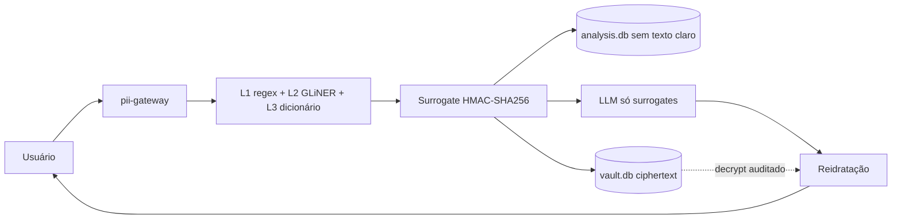

# pii-gateway

Demonstração do middleware descrito no relatório técnico: o texto com dados pessoais é pseudonimizado **antes** de sair da máquina, o modelo só vê substitutos determinísticos e a resposta é reidratada aqui. O banco analítico não recebe texto claro.

Isto é uma prova de conceito, não um produto.

## O que isto prova

1. Texto com PII entra e só surrogates seguem para o LLM.
2. A resposta volta com os valores reais, no perímetro local.
3. `analysis.db` guarda surrogate, tipo e hash. O valor original fica só cifrado em `vault.db`, e cada decrypt grava uma linha em `vault_access_log`.



## Quickstart

Requer Python 3.13. O `uv` instala o interpretador se precisar.

```bash
uv sync
cp .env.example .env
uv run uvicorn pii_gateway.app:app --host 127.0.0.1 --port 8000
```

Abra http://127.0.0.1:8000.

O workspace separa preparação do documento, contexto do caso e consulta. Os quatro painéis mostram o percurso da informação; detecções, bancos e auditoria ficam recolhidos em **Inspeção técnica**. **Configurar OCR** abre as opções locais e suas instruções de instalação.

Para a L2 de verdade (baixa o `torch` e, na primeira chamada, o modelo):

```bash
uv sync --extra ner
```

`ENABLE_NER` vem ligado no `.env.example`. Sem o extra, a API avisa e segue com L1 e L3. Os testes não baixam modelo.

Sem chave de provedor, ponha `LLM_MOCK=true` no `.env` para a síntese local. Com chave, use a API compatível com OpenAI (`LLM_BASE_URL`, `LLM_API_KEY`, `LLM_MODEL`). Não commite o `.env`.

Docker, sem o modelo neural:

```bash
docker compose up --build
```

## Roteiro de cinco minutos

1. Suba o servidor e abra a página. O texto de exemplo já é um caso **inventado** (Helena Duarte Ferreira, Oficina Luminar Ltda, CPF `123.456.789-09`, CNPJ `12.345.678/0001-95`, e-mail em `example.com`).
2. Confira o dicionário do caso e a allow-list. O tribunal e o Ministério Público ficam em claro de propósito.
3. Clique em **Sanitizar e perguntar**.
4. Compare os quatro painéis: o texto enviado ao LLM só tem tokens `PERSON_`, `CPF_`, `ORG_` e afins; a resposta reidratada devolve os valores.
5. Olhe as tabelas lado a lado. Em `analysis` não há o nome nem o CPF; em `vault` o ciphertext está em base64 e o log ganha uma linha `rehydrate` por decrypt. **Limpar stores** zera os dois arquivos para repetir.

## Como a demo decide

- **L1.** Regex e dígito verificador (módulo 11) para CPF e CNPJ. E-mail por formato. Telefone brasileiro por DDD e forma (móvel com 9, fixo com 2–5): não existe dígito verificador nacional.
- **L2.** GLiNER em processo, CPU, modelo conferido: [`urchade/gliner_multi_pii-v1`](https://huggingface.co/urchade/gliner_multi_pii-v1). Carga preguiçosa. Textos longos são percorridos em janelas sobrepostas, ajustadas ao tokenizador, com offsets globais e deduplicação. Desliga com `ENABLE_NER=false`.
- **L3.** Termos do caso, busca sem acento e sem diferença de maiúsculas. Um acerto da L2 entra no dicionário e é procurado no texto inteiro, inclusive a variação `H. Ferreira`. A allow-list tira o termo da redação.
- **Sobreposição.** O trecho mais longo vence. No empate, L1 > L3 > L2. Um identificador da L1 que não fique inteiro dentro do vencedor é mantido e o outro trecho é partido ao redor dele.
- **Surrogate.** `PREFIXO_` mais os 8 primeiros hex de `HMAC-SHA256(Norm(v), TENANT_KEY)`. Prefixos: `PERSON`, `ORG`, `CPF`, `CNPJ`, `EMAIL`, `PHONE`, `ADDRESS`. A normalização tira a máscara de CPF, CNPJ e telefone, então `123.456.789-09` e `12345678909` coincidem. O tipo não entra no HMAC. Se o surrogate de 8 hex já apontar para outro valor, o hex cresce (12, 16, 24, 32, 64). Colisão do HMAC inteiro responde 409.
- **Cofre.** AES-256-GCM (`cryptography`). `VAULT_KEY` em hex/base64 de 32 bytes, ou qualquer frase da qual se deriva SHA-256.
- **Stores.** Dois SQLite (`ANALYSIS_DB_URL`, `VAULT_DB_URL`) via SQLAlchemy, com `String`, `DateTime` e `LargeBinary`. Trocar para Postgres é trocar a URL. `entity.value_hash` é o HMAC completo, não o texto.

A reidratação de stream, com retenção de 32 caracteres para um surrogate partido entre chunks, está em `pii_gateway/stream.py` e coberta por teste. O endpoint `/ask` desta demo não transmite em streaming.

## Importar PDF

Na interface, selecione um arquivo em **Importar PDF (texto ou escaneado)**. A extração ocorre no servidor local, em memória: o arquivo, as imagens renderizadas e seus metadados não são salvos nem enviados ao LLM. O texto extraído preenche o **Texto do caso** para revisão. O dicionário e a allow-list do exemplo são limpos para não serem aplicados ao novo documento.

Cada página usa extração direta com `pypdf` quando possível. Se não houver texto utilizável, se a camada textual parecer corrompida ou se imagens ocuparem pelo menos 15% da área da página, a página inteira passa por OCR local. Isso evita considerar apenas um cabeçalho digital em uma página escaneada. A detecção é heurística; a opção **Forçar OCR** reprocessa todas as páginas quando a camada de texto existente estiver errada.

O OCR usa PDFium (`pypdfium2`) para renderizar uma página por vez a 300 DPI. O padrão continua sendo Tesseract em português por stdin/stdout; outros motores locais são selecionáveis em **Configurar OCR**. Não cria arquivos temporários de documentos. A importação mostra progresso por página e permite cancelar; o cancelamento sinaliza o worker e encerra o subprocesso OCR ativo. A renderização em andamento só é interrompida após retornar do PDFium. As chamadas PDFium são serializadas porque a biblioteca não é thread-safe.

O texto só retorna após todas as páginas terminarem. Páginas sem texto reconhecido após OCR não interrompem a importação: ficam em `page_info` com o número original, `method: "empty"` e `review_required: true`, e geram aviso. O sistema não presume que estejam em branco, pois também podem estar ilegíveis; revise essas páginas para conferir se faltou conteúdo. Elas não acrescentam texto artificial ao caso. Um PDF inteiro sem texto reconhecido conclui com texto vazio e avisos; a interface não permite perguntar sem conteúdo. Falhas reais do parser/OCR ou cancelamento continuam impedindo a importação parcial. Palavras com confiança inferior a 60 no Tesseract geram aviso de revisão da página; esse valor é uma heurística, não uma probabilidade de acerto nem validação da proteção de PII.

Depois de revisar o texto e preencher o dicionário do caso, clique em **Sanitizar e perguntar**. Texto e pergunta passam pelo mesmo pipeline L1/L2/L3; somente então há consulta ao provedor configurado. Os dados detectados entram nos mesmos stores, com valores originais cifrados no cofre.

- API: `POST /extract-pdf`, corpo binário com `Content-Type: application/pdf`; retorna `text`, `pages`, `page_info`, `warnings` e `conservative_pii`, com `Cache-Control: no-store`. Não chama o LLM nem grava nos stores. `?force_ocr=true` força OCR em todas as páginas.
- Ambas as rotas de importação aceitam `backend=tesseract|rapidocr|paddleocr|smoldocling|paddleocr-vl` e `device=cpu|cuda`. `ocr_backend` na resposta identifica o motor escolhido (páginas digitais ainda dispensam OCR). CUDA só é oferecido nos adaptadores VLM e precisa estar disponível; não há fallback silencioso para CPU ou outro motor.
- A interface usa `POST /extract-pdf/stream`, com o mesmo corpo e query, retornando NDJSON: eventos `progress` com contagem/método e um único `complete` com o texto integral, ou `error` com mensagem genérica. Erros de processamento chegam como eventos após HTTP 200; não trate esse status sozinho como sucesso. Abortar o fetch cancela o processamento. Nenhum evento de progresso contém texto do documento.
- A aplicação não impõe limites de tamanho do arquivo, páginas ou caracteres extraídos. O processamento depende da memória e da capacidade do PC; arquivos grandes podem demorar ou esgotar recursos. Formato HTTP incorreto retorna 415; documento inválido, vazio ou cifrado, 422.
- A importação ativa `conservative_pii=true` na consulta posterior: além dos documentos válidos, L1 substitui possíveis CPF/CNPJ com dígitos inválidos, espaços ou confusões comuns de OCR (`O`, `I`, `l`, `L`, `S`). Candidatos incertos recebem `review_required=true` nas detecções. Essa opção também pode ser enviada a `/sanitize` e `/ask`; aceita falsos positivos por precaução e não corrige o identificador original. Para erros com letras, a normalização do HMAC preserva a distinção entre as grafias em vez de descartar as letras.
- Anexos, anotações e manuscritos não têm cobertura garantida. A ordem e a completude da extração precisam de revisão. Não há isolamento do parser nem controle de consumo de recursos contra arquivos hostis; esta demo é local e não deve ser exposta como serviço público de uploads.
- **Não há garantia de anonimização ou detecção completa de PII.** OCR pode errar nomes, documentos e e-mails. As janelas sobrepostas da L2 evitam limitar a análise à primeira parte do documento, mas não garantem detecção perfeita. Use documentos fictícios na demonstração e revise o dicionário; dados não detectados e termos na allow-list podem seguir em claro ao provedor. O limite de contexto do LLM externo continua existindo e não há sumarização automática para contorná-lo.

### Instalar o OCR local

`uv sync` instala as bibliotecas Python, mas o executável **Tesseract** e seu modelo de português são dependências do sistema. O OCR só é necessário quando uma página precisar dele; PDFs textuais continuam funcionando sem Tesseract.

- **Windows:** instale `winget install --id tesseract-ocr.tesseract --exact` e disponibilize `por.traineddata` do repositório oficial [tessdata_best](https://github.com/tesseract-ocr/tessdata_best). O gateway procura o executável no PATH e em `Tesseract-OCR` dentro de Program Files/LocalAppData. Também reconhece modelos em `%LOCALAPPDATA%\pii-gateway\tessdata` quando todos os idiomas solicitados estão nessa pasta.
- **Linux/WSL:** `sudo apt-get install tesseract-ocr tesseract-ocr-por`. A imagem Docker já instala ambos.
- Configuração opcional no ambiente/`.env`: `TESSERACT_CMD` (caminho do executável), `TESSERACT_LANG` (padrão `por`, aceita idiomas instalados como `por+eng`) e `TESSDATA_PREFIX` (pasta dos modelos). Se não houver modelo para o idioma, a importação falha com mensagem de configuração, sem consulta ao LLM.
- Testes usam PDFs fictícios em memória e doubles de OCR/NER: não executam Tesseract nem baixam modelos.

### Escolher o motor de OCR

**Configurar OCR**, no topo da interface, permite escolher motor e dispositivo. A preferência fica no `localStorage` **apenas deste navegador**; documentos, textos e segredos não são armazenados ali. A mudança vale para a próxima importação e não reprocessa o texto atual. Arquivos/dependências ausentes são indicados, com comandos de preparação: salvar a escolha não instala pacotes nem baixa pesos. **Atualizar disponibilidade** consulta novamente o servidor.

`GET /ocr/options` retorna o catálogo e a disponibilidade sem importar modelos pesados ou executar inferência. "Preparado" significa apenas que os arquivos/dependências foram encontrados, não que o backend tenha sido testado ou sua precisão validada.

Padrões do servidor no ambiente/`.env` (não contêm credenciais):

```dotenv
OCR_BACKEND=tesseract
OCR_DEVICE=cpu
```

| Motor | Preparação | Observações |
| --- | --- | --- |
| Tesseract | Executável e `por.traineddata`, conforme acima | CPU; padrão e alternativa leve. |
| RapidOCR / PP-OCRv5 Mobile | `uv sync --extra ocr-rapid`, depois `uv run --no-sync python -m pii_gateway.ocr_setup rapidocr` | CPU/ONNX. Usa explicitamente reconhecedor latino para português, sem o reconhecedor chinês padrão. |
| PaddleOCR / PP-OCRv5 | `uv sync --extra ocr-paddle`; instale também [PaddlePaddle](https://www.paddlepaddle.org.cn/en/install/quick) compatível com SO/Python; prepare modelos locais abaixo | Adaptador CPU com `lang=pt`; dependências nativas variam por plataforma. |
| SmolDocling 256M | `uv sync --extra ocr-vlm`, depois `uv run --no-sync python -m pii_gateway.ocr_setup smoldocling` | CPU ou CUDA. Experimental para português; saída DocTags convertida via Docling Core. |
| PaddleOCR-VL 1.6 | `uv sync --extra ocr-vlm`, depois `uv run --no-sync python -m pii_gateway.ocr_setup paddleocr-vl` | CPU ou CUDA; GPU recomendada. Leitura generativa, sujeita a omissões/invenções. |

Extras podem ser combinados: `uv sync --extra ner --extra ocr-rapid` preserva o ambiente com NER e RapidOCR. Pare o servidor antes de atualizar dependências nativas no Windows, para evitar DLLs bloqueadas. Os motores opcionais não entram na instalação base ou na imagem Docker padrão.

O comando `ocr_setup` baixa **somente modelos**, nunca recebe documentos. RapidOCR usa arquivos ONNX do release `RapidAI/RapidOCR v3.10.0`, com SHA-256 conferido antes de disponibilizar os pesos. Os VLMs usam os repositórios `docling-project/SmolDocling-256M-preview` e `PaddlePaddle/PaddleOCR-VL-1.6`; esses downloads são maiores e explícitos. O código remoto dos repositórios não é habilitado.

Por padrão, modelos ficam em `%LOCALAPPDATA%/pii-gateway/models/<backend>` no Windows ou `~/.cache/pii-gateway/models/<backend>` nos demais sistemas. Pastas alternativas podem ser definidas por backend:

- `RAPIDOCR_MODEL_DIR`: `det.onnx`, `rec.onnx`, `keys.txt` (gerados pelo setup).
- `PADDLEOCR_MODEL_DIR`: subpastas `det` e `rec` com os bundles de inferência `PP-OCRv5_mobile_det` e `latin_PP-OCRv5_mobile_rec`. Consulte a [documentação de implantação local](https://www.paddleocr.ai/main/en/version3.x/pipeline_usage/OCR.html); o gateway não escolhe outro modelo nem baixa pesos faltantes.
- `SMOLDOCLING_MODEL_DIR` / `PADDLEOCR_VL_MODEL_DIR`: snapshot local completo do respectivo modelo Transformers e processador.

Os motores opcionais rodam em subprocesso isolado por PDF, reutilizando o modelo entre páginas e encerrando-o no fim ou cancelamento. Imagens e respostas trafegam por pipes; diagnósticos de dependências não são expostos nos logs da demo. A inferência usa modelos locais, modo offline do Hugging Face e bloqueio de conexões Python no worker (isso **não é um sandbox de segurança** para bibliotecas nativas). Nenhum endpoint aceita URL de serviço externo ou identificador arbitrário de modelo vindo do navegador.

O VLM não tem confiança OCR calibrada: suas páginas sempre pedem revisão. Ele tem orçamento de geração por página; se atingir esse orçamento sem terminar, a importação falha em vez de retornar texto truncado. Isso não impõe um teto ao tamanho ou ao número de páginas do PDF. Compare precisão de nomes, documentos e e-mails e consumo de memória no hardware-alvo antes de trocar o padrão.

## O que é simulado e o que ficou de fora

- **KMS simulado.** A chave do cofre vive no processo. Não há envelope encryption nem chave por tenant num KMS.
- **Fora de escopo:** KMS real, Postgres de fato, avaliação (TAE ou corpus anotado), cartão, IBAN e número CNJ.

Documento real de processo não entra neste repositório. O exemplo da interface é fictício.
